<div align="center">

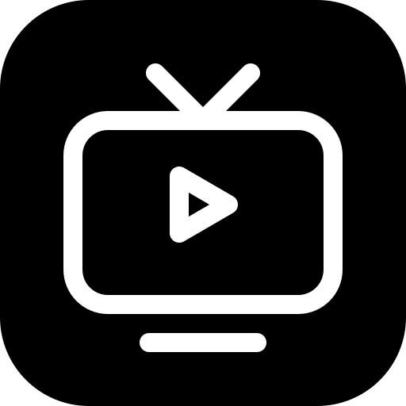

# OpenTV

**TV en vivo, películas y series en una sola app para Windows, Fire TV, Android TV, celulares Android y TV LG.**
Interfaz moderna estilo streaming, rápida con ratón, teclado, pantalla táctil o control remoto.

[](https://github.com/EdgarLeonArchuleta19/OpenTV/releases/latest)


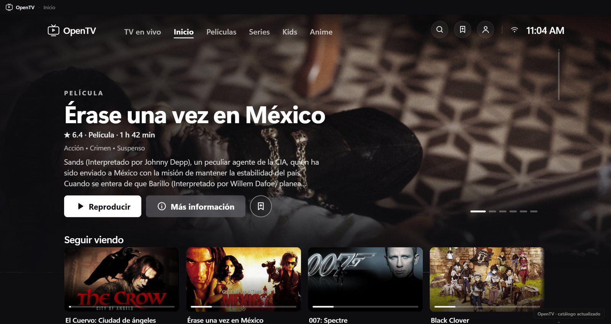

</div>

---

## ✨ Qué tiene

| | |
|---|---|
| 🎬 **Inicio estilo streaming** | Portada a todo el ancho que rota entre títulos, **Seguir viendo** con progreso, **Top 10** con números grandes y filas por temas. Al dejar el ratón sobre un póster aparece una tarjeta con reproducir, Mi lista y detalles. |
| 📺 **TV en vivo** | Más de 1000 canales por país y tema, vista previa sin salir del inicio, **Guía de canales** (tecla `G`) con buscador, **Favoritos** y **Recientes**. |
| 🔎 **Buscador** | Sugerencias del catálogo mientras escribes y búsquedas recientes. |
| ▶️ **Reproductor** | Controles tipo Netflix, volumen (controla el de Windows), velocidad 0,5×–2×, calidad, audio y subtítulos, siguiente episodio automático, ventana flotante y pantalla completa. Si un vídeo falla, cambia solo a un modo compatible. |
| 🗂️ **Episodios** | Panel lateral con temporadas y episodios mientras ves la serie. |
| 👤 **Perfiles** | Hasta 6 perfiles con avatar, cada uno con su historial, Mi lista, búsquedas y canales favoritos. Perfil infantil (solo Kids). Con varios perfiles la app abre en *¿Quién está viendo?*. Copia automática en `Documentos\OpenTV` para recuperarlos al reinstalar. |
| 📺 **En la tele** | En Fire TV, Android TV y TV LG: menú a la izquierda, todo se maneja con el control remoto y el vídeo va por el reproductor nativo (ExoPlayer en Android). Pensada para ir fluida incluso en un Fire TV Stick de 1 GB. |
| 📱 **En el celular** | Diseño propio para pantallas táctiles: barra inferior (Inicio, Películas, Series, TV en vivo, Mi cuenta), filtros Kids, Anime y Mi lista, y vista horizontal. |
| 🔒 **Privacidad** | Sin cuentas ni registro: tu lista, historial y preferencias se guardan solo en tu equipo. |
| 🧩 **Modo Addons** · solo PC | En **Ajustes → Fuentes** eliges de dónde salen las películas y series: **Modo automático** (el catálogo integrado, recomendado) o **Modo Addons**, con tus addons (compatibles con Stremio) (vienen instalados Cinemeta para el catálogo y OpenSubtitles para los subtítulos; las fuentes, como Torrentio, las agregas tú). Filas, fichas, búsqueda y subtítulos salen de tus addons, y al reproducir eliges la fuente: enlace directo o **torrent**. TV en vivo no cambia: tiene sus propias listas M3U. |
| 🔄 **Actualizaciones automáticas** | En Windows, la versión instalada se actualiza sola desde las releases de este repositorio. En Android y LG, se instala el paquete nuevo encima y se conservan los datos. |
| ⚡ **Rápida** | 60 fps al navegar, carga diferida de pósteres y listas, y un registro de errores local para depurar. |

## 📸 Capturas

<table>
  <tr>
    <td>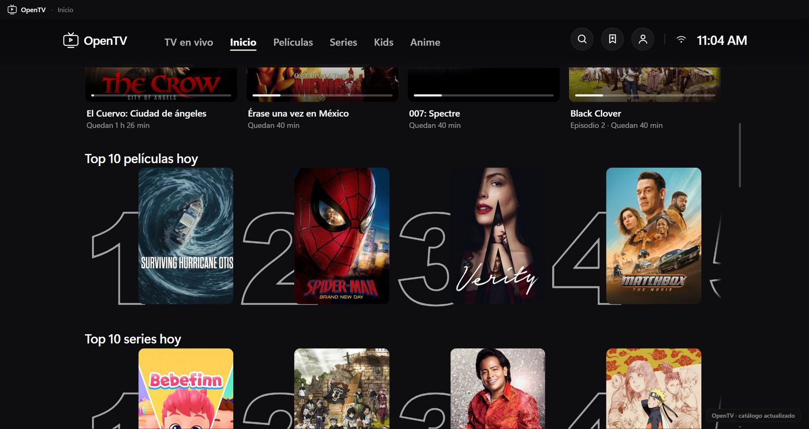</td>
    <td>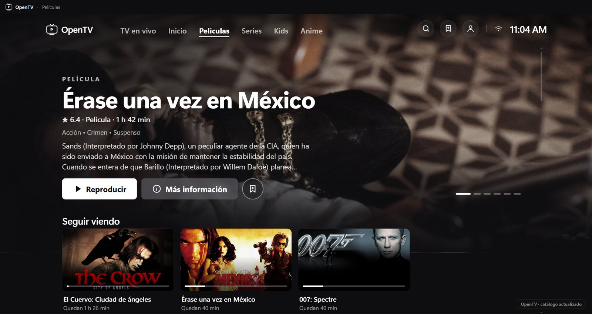</td>
  </tr>
  <tr>
    <td>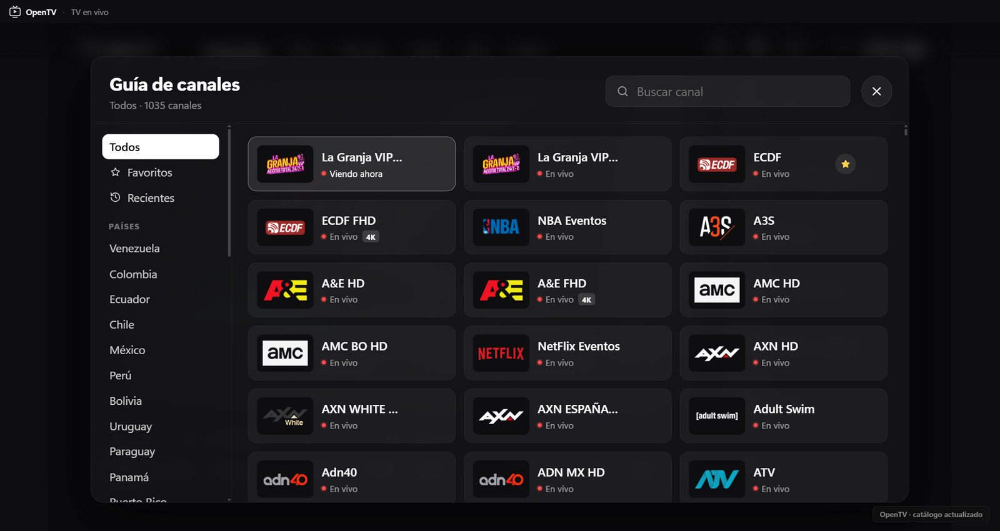</td>
    <td>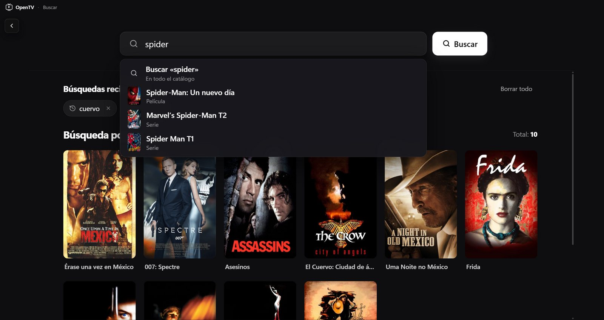</td>
  </tr>
  <tr>
    <td>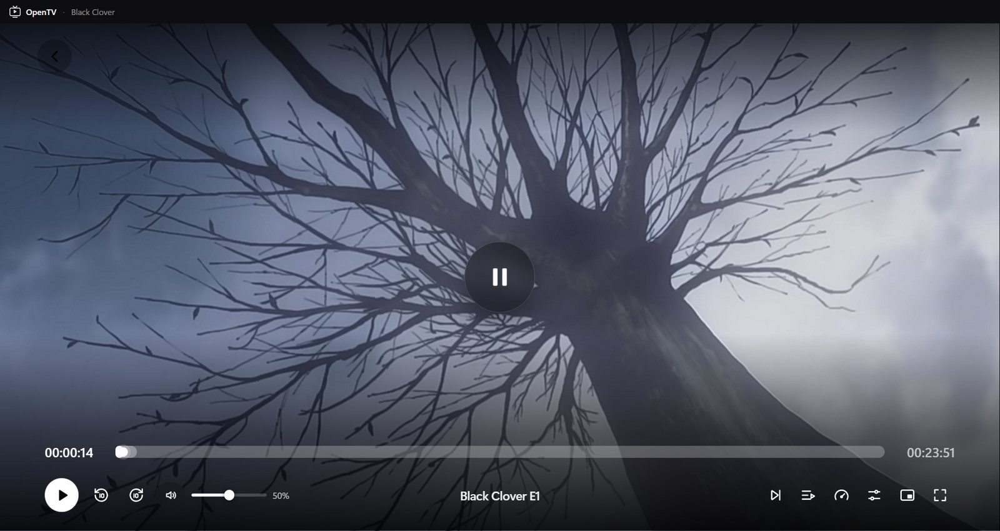</td>
    <td>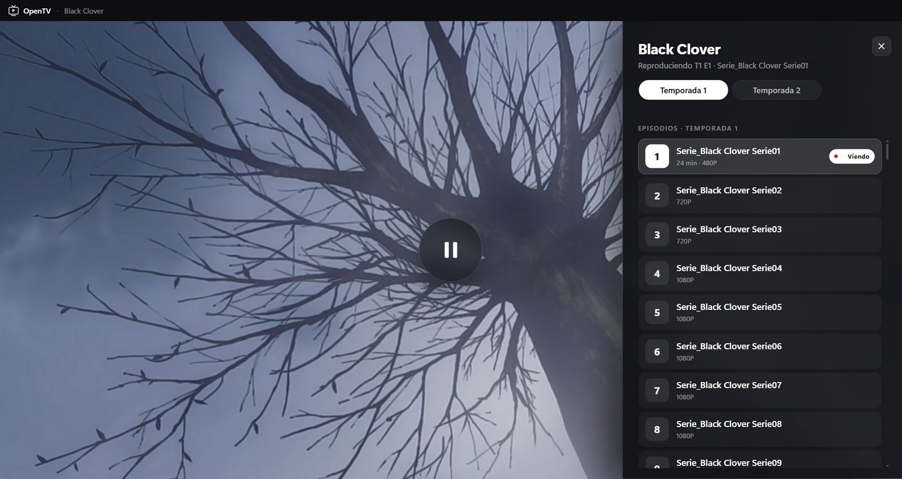</td>
  </tr>
  <tr>
    <td colspan="2">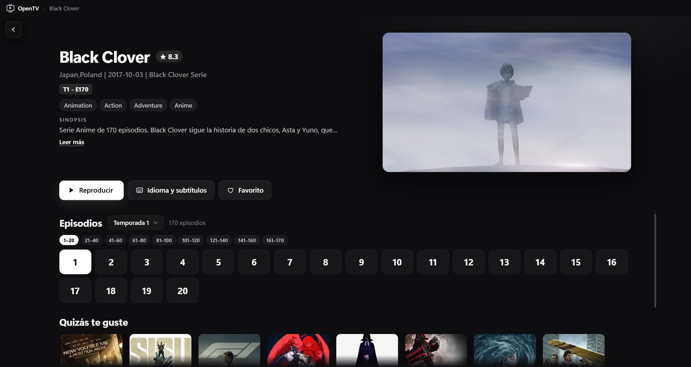</td>
  </tr>
  <tr>
    <td>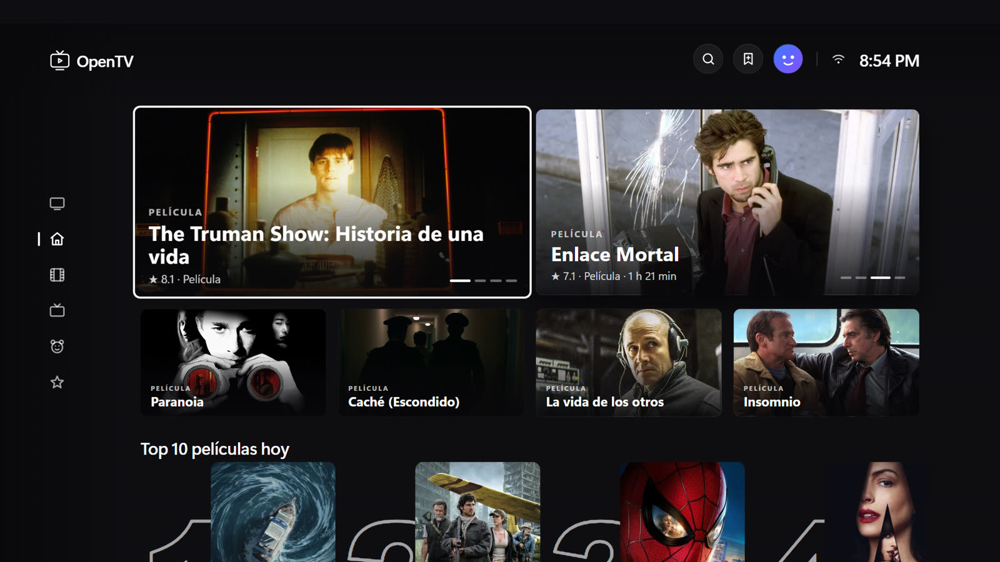<br><sub>En la tele (Fire TV, Android TV, TV LG)</sub></td>
    <td align="center">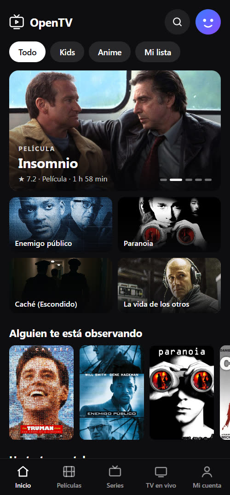<br><sub>En el celular Android</sub></td>
  </tr>
</table>

## ⬇️ Descargar e instalar

Todo está en **[Releases](https://github.com/EdgarLeonArchuleta19/OpenTV/releases/latest)**:

| Dispositivo | Archivo |
|---|---|
| Windows 10/11 (instalador) | `OpenTV-Setup-x.y.z.zip` |
| Windows sin instalar | `OpenTV-Portable-x.y.z.zip` |
| Fire TV, Android TV y celulares Android | `OpenTV-x.y.z.apk` (el mismo archivo para los tres) |
| TV LG (webOS) | `OpenTV-LG-x.y.z.ipk` |

### Windows

1. Entra en **[Releases](https://github.com/EdgarLeonArchuleta19/OpenTV/releases/latest)** y descarga **`OpenTV-Setup-x.y.z.zip`**.
2. Descomprime el `.zip` y abre **`OpenTV-Setup-x.y.z.exe`**.
3. Si Windows muestra *"Windows protegió su PC"*, pulsa **Más información → Ejecutar de todas formas** (la app no está firmada con un certificado de pago).

¿Sin instalar? Descarga **`OpenTV-Portable-x.y.z.zip`**: es un solo `.exe` que se abre directamente y guarda tus datos en una carpeta a su lado.

> La versión instalada busca actualizaciones al abrirse y cada 6 horas, y las instala al cerrar la app. La portable avisa cuando hay una nueva.

### Fire TV y Android TV

La app es un APK (`OpenTV-x.y.z.apk`, unos 5 MB) que se instala por fuera de la tienda. Dos formas:

**Con la app Downloader (sin PC)**
1. En la Fire TV: **Configuración → Mi Fire TV → Opciones para desarrolladores → Instalar apps desconocidas** y activa **Downloader** (instálala antes desde la tienda; si no ves *Opciones para desarrolladores*, entra en **Mi Fire TV → Acerca de** y pulsa 7 veces sobre el nombre del dispositivo).
2. Abre Downloader, escribe el enlace directo al `.apk` y pulsa **Instalar**.

**Desde el PC por la red (adb)**
1. En la Fire TV: **Opciones para desarrolladores → Depuración ADB: activada**, y apunta su IP en **Mi Fire TV → Acerca de → Red**.
2. En el PC (con [platform-tools](https://developer.android.com/tools/releases/platform-tools)):
   ```bash
   adb connect 192.168.1.X:5555      # acepta el aviso que sale en la tele
   adb install -r OpenTV-x.y.z.apk
   ```

OpenTV aparece en **Tus apps y canales**; con el botón ☰ del control puedes moverla al inicio.
Para actualizar, instala el APK nuevo encima: se conservan perfiles e historial.

### Celular Android

1. Abre la página de [Releases](https://github.com/EdgarLeonArchuleta19/OpenTV/releases/latest) desde el celular y descarga `OpenTV-x.y.z.apk`.
2. Ábrelo desde las descargas. La primera vez Android pide permiso para **instalar apps de origen desconocido** desde el navegador: actívalo y vuelve a abrir el archivo.
3. Para actualizar, descarga e instala el APK nuevo encima.

### TV LG (webOS)

Las teles LG solo instalan apps de fuera de la tienda en **modo desarrollador**:

1. En la tele, instala **Developer Mode** desde la LG Content Store, inicia sesión con una cuenta de [LG Developer](https://webostv.developer.lge.com/) y activa **Dev Mode Status** y **Key Server** (la tele se reinicia).
2. En el PC, instala el CLI de webOS (`npm i -g @webos-tools/cli`) y registra la tele con `ares-setup-device` (usa la IP y la frase que muestra la app Developer Mode).
3. Instala el paquete:
   ```bash
   ares-install --device mitele OpenTV-LG-x.y.z.ipk
   ```

> La sesión del modo desarrollador de LG caduca si no se renueva desde la app Developer Mode (botón **Extend**); si caduca, la tele quita las apps instaladas así.

## ⌨️ Atajos

| Acción | Atajo |
|---|---|
| Reproducir / pausar | `Espacio` o clic en el vídeo |
| Retroceder / adelantar 10 s | `←` / `→` (o mantener pulsado un lado del vídeo) |
| Volumen | Rueda del ratón sobre el vídeo · `M` silencia |
| Pantalla completa | `F`, `F11` o doble clic (salir con `Esc`) |
| Ventana flotante | `Ctrl + P` |
| Guía de canales (TV) | `G` |
| Buscar / Inicio / Historial / Ajustes | `Ctrl + F` / `Ctrl + H` / `Ctrl + J` / `Ctrl + ,` |
| Volver | `Esc`, `Backspace` o `Alt + ←` |
| Ayuda y lista completa de atajos | `F1` |

## 🛠️ Desarrollo

Requisitos: **Node.js 22+** y Windows 10/11 x64.

```bash
npm install          # dependencias
npm run dev          # abrir la app en modo desarrollo
npm run build        # regenerar ui/js/app.js y los estilos (Tailwind)
npm test             # pruebas: bundle ES5 para TV, catálogo, búsqueda, guía, M3U…
npm run test:e2e     # abre la interfaz real en Electron y recorre las pantallas
npm run snapshot     # actualizar la copia del catálogo incluida (necesita internet)
npm run dist         # instalador + portable en dist/
npm run build:webos  # paquete de la TV LG en dist/webos (y .ipk si tienes ares-cli)
npm run build:android  # interfaz para Android en platforms/android/www + cap sync
npm run build:apk    # APK de Fire TV / Android TV / Android en dist/ (R8 y firmado)
```

**Android** necesita además JDK 17 (`JAVA_HOME`) y el Android SDK (`ANDROID_HOME`).
El APK se firma con la clave que indique `platforms/android/android/keystore.properties`
(ignorado por git; la clave `.jks` se guarda fuera del repositorio). Sin ese archivo se
firma con la clave de depuración, que vale para probar. **Guarda una copia de la clave
y su contraseña:** sin ellas no se puede actualizar la app ya instalada, habría que
desinstalarla (y se pierden perfiles e historial).

### Estructura

Una sola interfaz y un solo servicio para todas las plataformas; cada
plataforma solo añade su envoltorio (plan en [docs/PLATAFORMAS.md](docs/PLATAFORMAS.md)).

```
ui/                 Interfaz compartida (PC, teles y celulares)
  js/src/           Código en módulos ES5 → se une en ui/js/app.js (ver ui/js/src/README.md)
    mobile/         Diseño de celular (Android; iOS después)
  js/native-player.js  Android: el <video> pasa por ExoPlayer (no hace nada en otras plataformas)
  css/style.css     Base heredada de la versión LG (medidas del lienzo de 1920×1080)
  desktop/          Capas de estilo (desktop.css → modern.css → theme.css → tailwind.css),
                    HLS.js y adaptadores de PC
    tw/input.css    Fuente de tailwind.css: importa tw/capas/01…11 en orden
                    (10-teles.css = todo lo exclusivo de LG, Android TV y Fire TV;
                    11-fuentes-stremio.css = panel "Elegir fuente" del modo manual)
  mobile/mobile.css Estilos del diseño de celular
service/            Servicio local (Node): catálogo, proxy HLS, relay FFmpeg, DoH, TMDB
  torrents.js       Solo PC: reproduce torrents del modo manual (torrent-stream) y los sirve
                    en 127.0.0.1 con Range; la descarga se borra al salir de la película
platforms/
  electron/         Windows: ventana y barra de título, atajos, actualizaciones, volumen,
                    registro de errores, puente seguro e instalador (installer/)
  android/          Capacitor: servicio nativo en Java, ExoPlayer, imágenes redimensionadas
                    (release con R8: reglas en android/app/proguard-rules.pro)
  webos/            TV LG: appinfo.json (el paquete lo arma scripts/build-webos.cjs)
tests/              Pruebas unitarias (node --test) y de extremo a extremo (Electron)
scripts/            Build del bundle y de cada plataforma, copia del catálogo, publicación
  lib/ui-package.cjs  Copia y minifica la interfaz para los paquetes de LG y Android
  build-apk.cjs     Compila el APK de release (R8) y lo copia a dist/
bin/                ffmpeg.exe (Windows x64)
```

Los paquetes de LG y Android llevan la interfaz **minificada** (JS con terser
en ES5, CSS sin comentarios ni espacios, mismas reglas y en el mismo orden).
`ui/` y la app de PC conservan los archivos legibles.

### Publicar una versión

1. Sube `version` en `package.json` (por ejemplo `1.1.1`), en `platforms/webos/appinfo.json`, el texto `v…` de `ui/index.html` y, en `platforms/android/android/app/build.gradle`, `versionName` y `versionCode` (+1; si no sube, Android no instala la nueva encima).
2. Compila y prueba:
   ```bash
   npm run build && npm test
   npx electron-builder --win nsis portable
   ```
3. Compila Android y LG: `npm run build:apk` y `npm run build:webos` (el `.ipk` necesita `ares-package`).
4. Crea la release `v1.1.1` y sube **el `.zip` del instalador** (para descargar) junto con
   `OpenTV-Setup-1.1.1.exe`, su `.blockmap` y `latest.yml` (los usa el actualizador automático),
   el portable, el `.apk` y el `.ipk`.

También hay un workflow de GitHub Actions listo en [`scripts/ci/github-release.yml`](scripts/ci/github-release.yml): cópialo a `.github/workflows/` y cada etiqueta `v*` compilará y publicará sola.

## ⚖️ Aviso

OpenTV es un reproductor. **No aloja, sube ni distribuye contenido**: muestra catálogos y emisiones de servicios de terceros, y las listas M3U y addons que añada cada usuario. La app solo trae instalados Cinemeta (catálogo) y OpenSubtitles (subtítulos), que no dan vídeos; los addons de fuentes los agrega cada usuario, que es responsable de lo que reproduce. Al reproducir un torrent, la app comparte partes del archivo con otras personas mientras se ve (lo avisa antes de la primera vez). Los títulos, imágenes y marcas pertenecen a sus respectivos dueños. Úsala de acuerdo con las leyes de tu país.

Componentes de código abierto: [Electron](https://www.electronjs.org/) (MIT), [HLS.js](https://github.com/video-dev/hls.js) (Apache 2.0), [Capacitor](https://capacitorjs.com/) (MIT), [AndroidX Media3 / ExoPlayer](https://github.com/androidx/media) (Apache 2.0), [FFmpeg](https://ffmpeg.org/) (GPL v3), [torrent-stream](https://github.com/mafintosh/torrent-stream) (MIT) y [Tailwind CSS](https://tailwindcss.com/) (MIT). Las licencias completas están en [`licenses/`](licenses).

## 📄 Licencia

[MIT](LICENSE) · Desarrollado por **TECHPOINT Software™**
