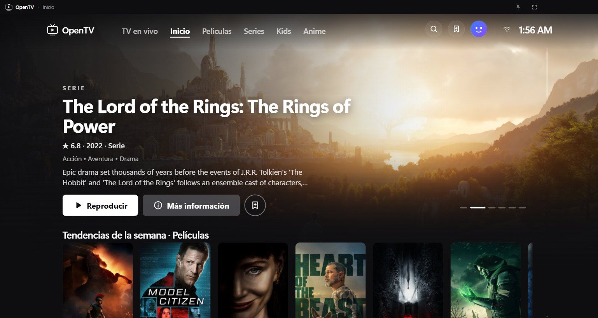
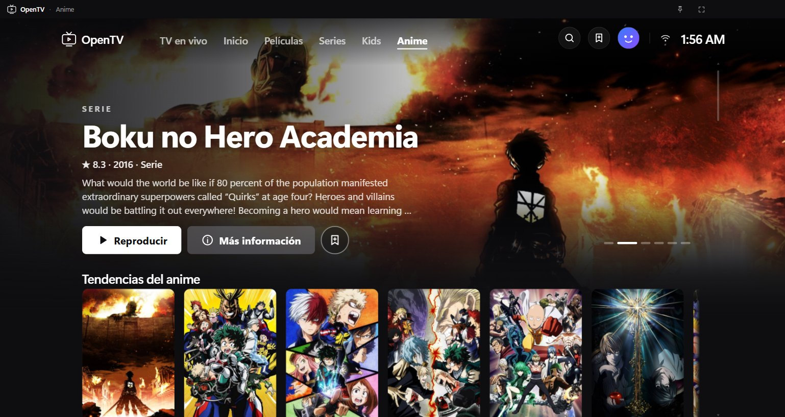
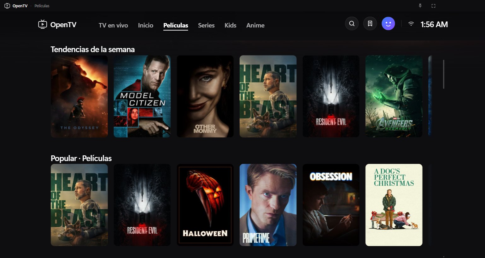
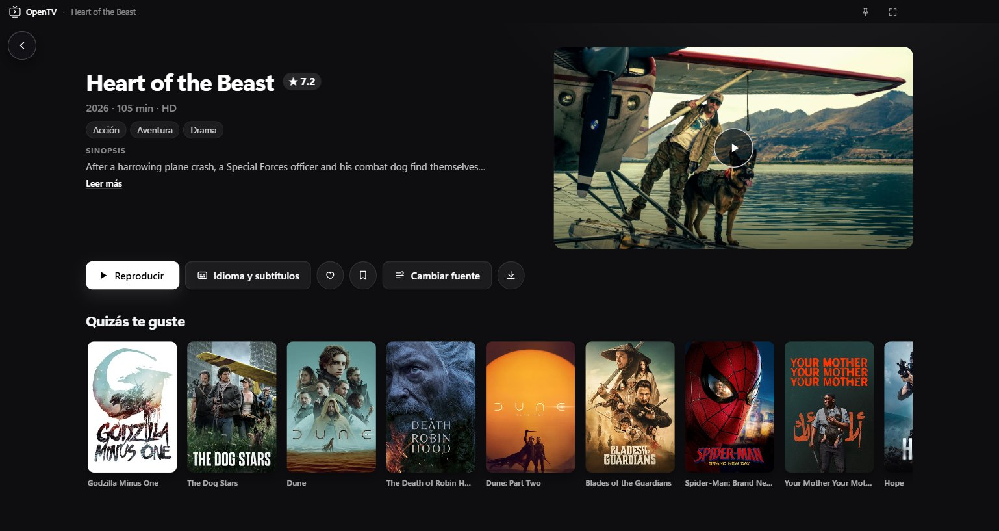
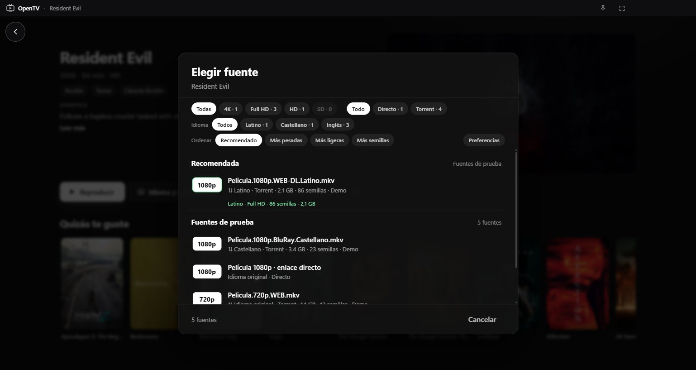
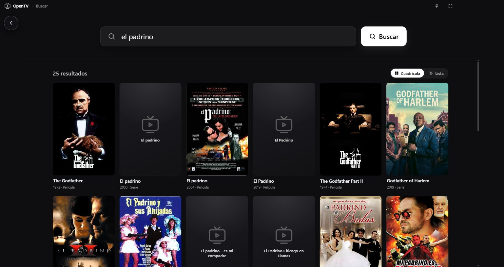
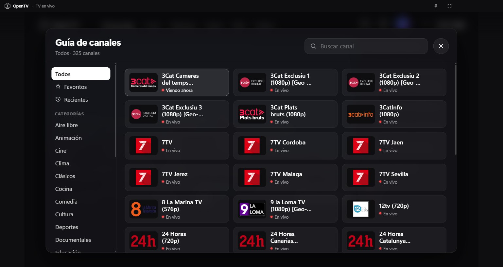
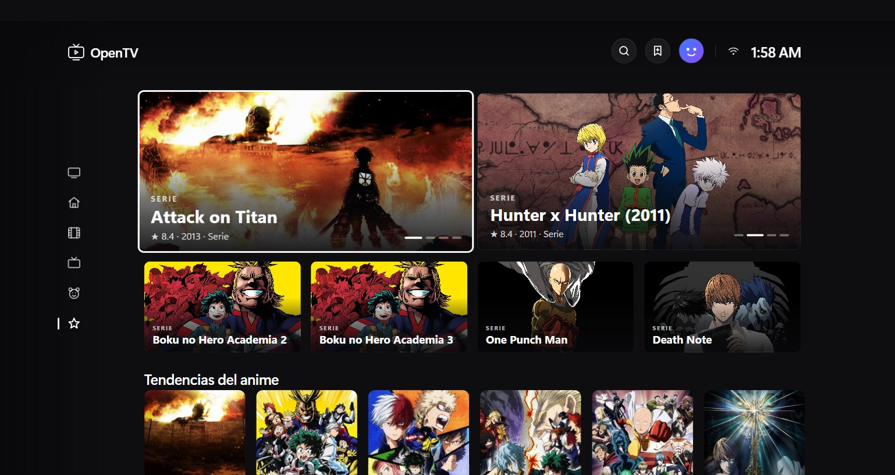
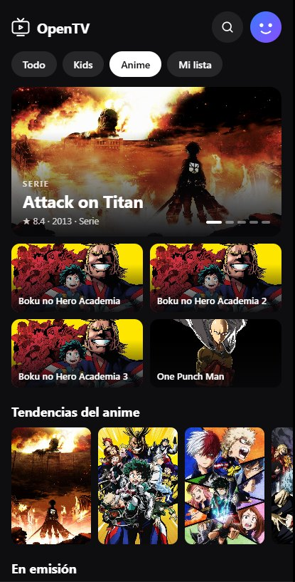

<div align="center">


# OpenTV

**Películas, series, anime y TV en vivo en una sola app, con tus addons y tus listas.**
Para Windows, Fire TV, Android TV y celulares Android. Compatible con los addons de Stremio y con listas M3U.

[](https://github.com/EdgarLeonArchuleta19/OpenTV/releases/latest)




</div>

---

## Qué es

OpenTV es un **reproductor**: no trae contenido propio. Las películas, series y
anime salen de los **addons** que tú eliges (los mismos que usa Stremio), y la
TV en vivo de **listas M3U**. OpenTV les da una sola interfaz, tipo streaming,
que funciona igual con ratón, teclado, pantalla táctil o control remoto.

```
Addons (compatibles con Stremio) ──► catálogo, fichas, fuentes y subtítulos ─┐
Listas M3U / IPTV ─────────────────► canales en vivo ────────────────────────┼─► OpenTV
TMDB (opcional) ───────────────────► tendencias y búsqueda en español ───────┘
```

### Addons que vienen instalados

| Addon | Para qué sirve |
|---|---|
| **Cinemeta** | Catálogo de películas y series: pósteres, fichas, temporadas y capítulos |
| **Anime Kitsu** | Catálogo de anime japonés para la sección **Anime**: en emisión, populares, mejor valorados |
| **OpenSubtitles** | Subtítulos en varios idiomas |

Vienen siempre y no se pueden quitar. Ninguno de ellos da vídeos. **Para reproducir hace falta un addon de fuentes**,
que agrega cada usuario en **Ajustes → Plugins** pegando la URL de su
`manifest.json`. Sin él, la app funciona igual: muestras las fichas, tu lista y
el historial, y al darle a *Reproducir* te dice dónde agregar uno.

## ✨ Qué tiene

| | |
|---|---|
| 🧩 **Addons** | Pega la URL de cualquier addon compatible con Stremio: sus catálogos se vuelven filas del inicio, sus fichas y capítulos se ven en OpenTV y sus fuentes aparecen al reproducir. Los que agregas se pueden quitar y reordenar; los tres que trae la app se quedan. |
| 🎯 **Elegir fuente** | Panel con las fuentes de todos tus addons, con calidad, tamaño, idioma y semillas. OpenTV marca una **Recomendada** (primero tu idioma, luego la calidad, luego la salud del torrent; CAM solo si no hay otra) y puede elegirla sola. Filtros por idioma (Latino, Castellano, Inglés) y calidad. |
| ⚙️ **Preferencias de addons** | Como la página *configure* de Torrentio, pero dentro de la app: idiomas preferidos, calidades que nunca quieres ver (4K, SD, CAM…), semillas mínimas, tamaño máximo y proveedores. |
| 🧲 **Torrents** | En PC y en Android 9+ (incluida la Fire TV). Se ven mientras se descargan y se borran al salir. La app lo avisa la primera vez. |
| ⬇️ **Descargas** | Guarda una película o un capítulo para verlo sin internet (PC y celular Android, con notificación de progreso; en la tele no). Se reanudan si se cortan. |
| 💬 **Subtítulos** | Los que trae el archivo, los de tus addons (OpenSubtitles) o un `.srt`/`.vtt` tuyo. Tamaño, color y desfase ajustables. |
| 🔊 **Audio** | Cambia de pista viendo el idioma real (Latino, Castellano, Inglés…). |
| 🌸 **Anime** | Sección propia con el catálogo de Kitsu: anime japonés de verdad, no caricaturas. |
| 🔎 **Buscador** | Busca en todos tus addons a la vez, con el mejor resultado primero. Entiende títulos en español: *"el padrino"* encuentra *The Godfather*. |
| 📺 **TV en vivo** | Tus listas M3U/IPTV. Viene con una lista pública de prueba y un buscador de más de 15 listas públicas de [iptv-org](https://github.com/iptv-org/iptv) por país y tema. **Guía de canales** (tecla `G`), favoritos y recientes. |
| 🎬 **Inicio estilo streaming** | Portada que rota entre títulos, **Seguir viendo** con progreso, tendencias de la semana y filas de tus addons. |
| ▶️ **Reproductor** | Controles tipo Netflix, velocidad 0,5×–2×, siguiente capítulo, panel de episodios, ventana flotante y pantalla completa. En PC, los MKV/AVI se reproducen con FFmpeg sin perder la sincronía de audio y vídeo; en Android, con ExoPlayer. |
| 👤 **Perfiles** | Hasta 6, cada uno con su historial, Mi lista, búsquedas y canales favoritos. Perfil infantil (solo Kids). |
| 📺 **En la tele** | En Fire TV y Android TV se maneja con el control remoto y el vídeo va por el reproductor nativo. Pensada para ir fluida en un Fire TV Stick de 1 GB. |
| 📱 **En el celular** | Diseño propio para pantalla táctil: barra inferior, filtros Kids / Anime / Mi lista y ventanas que suben desde abajo. Agrega addons y listas desde el teléfono. |
| 🧭 **Guía de inicio** | La primera vez explica en cuatro pasos cómo funciona; luego está en **Ayuda**. |
| 🔄 **Actualizaciones** | Windows se actualiza solo. En Android la app avisa de una versión nueva y la instala sin perder los datos. |
| 🔒 **Privacidad** | Sin cuentas ni registro: todo se guarda en tu equipo. El servicio local solo escucha en `127.0.0.1`. |

## 📸 Capturas

<table>
  <tr>
    <td><br><sub>Anime (Kitsu)</sub></td>
    <td><br><sub>Películas</sub></td>
  </tr>
  <tr>
    <td><br><sub>Ficha de un título</sub></td>
    <td><br><sub>Elegir fuente</sub></td>
  </tr>
  <tr>
    <td><br><sub>Buscador</sub></td>
    <td><br><sub>TV en vivo</sub></td>
  </tr>
  <tr>
    <td><br><sub>En la tele (Fire TV, Android TV)</sub></td>
    <td align="center"><br><sub>En el celular Android</sub></td>
  </tr>
</table>

## 🚀 Primeros pasos

1. **Instala** OpenTV (abajo).
2. **Agrega un addon de fuentes** en **Ajustes → Plugins**: elige uno en Comunidad o pega la URL de su `manifest.json` en Mis plugins.
3. **Ajusta tus preferencias** en **Ajustes → Preferencias de addons** (idioma, calidad).
4. **TV en vivo:** agrega tu lista M3U en **Ajustes → Plugins → Mis plugins**, o elige una lista pública en Comunidad.

En el celular, todo eso está en **Mi cuenta → Addons y listas**.

## ⬇️ Descargar e instalar

Todo está en **[Releases](https://github.com/EdgarLeonArchuleta19/OpenTV/releases/latest)**:

| Dispositivo | Archivo |
|---|---|
| Windows 10/11 (instalador) | `OpenTV-Setup-x.y.z.zip` |
| Windows sin instalar | `OpenTV-Portable-x.y.z.zip` |
| Fire TV, Android TV y celulares Android | `OpenTV-x.y.z.apk` (el mismo archivo para los tres) |

### Windows

1. Descarga **`OpenTV-Setup-x.y.z.zip`** de [Releases](https://github.com/EdgarLeonArchuleta19/OpenTV/releases/latest).
2. Descomprímelo y abre **`OpenTV-Setup-x.y.z.exe`**.
3. Si Windows muestra *"Windows protegió su PC"*, pulsa **Más información → Ejecutar de todas formas** (la app no está firmada con un certificado de pago).

¿Sin instalar? **`OpenTV-Portable-x.y.z.zip`** es un solo `.exe` que guarda tus datos en una carpeta a su lado.

> La versión instalada busca actualizaciones al abrirse y cada 6 horas, y las instala al cerrar la app. La portable avisa cuando hay una nueva.

### Fire TV y Android TV

El APK se instala por fuera de la tienda. Dos formas:

**Con la app Downloader (sin PC)**
1. En la Fire TV: **Configuración → Mi Fire TV → Opciones para desarrolladores → Instalar apps desconocidas** y activa **Downloader** (instálala antes desde la tienda; si no ves *Opciones para desarrolladores*, entra en **Mi Fire TV → Acerca de** y pulsa 7 veces sobre el nombre del dispositivo).
2. Abre Downloader, escribe el enlace directo al `.apk` y pulsa **Instalar**.

**Desde el PC por la red (adb)**
1. En la Fire TV: **Opciones para desarrolladores → Depuración ADB: activada**, y apunta su IP en **Mi Fire TV → Acerca de → Red**.
2. En el PC (con [platform-tools](https://developer.android.com/tools/releases/platform-tools)):
   ```bash
   adb connect 192.168.1.X:5555      # acepta el aviso que sale en la tele
   adb install -r OpenTV-x.y.z.apk
   ```

OpenTV aparece en **Tus apps y canales**; con el botón ☰ del control puedes moverla al inicio.

### Celular Android

1. Abre [Releases](https://github.com/EdgarLeonArchuleta19/OpenTV/releases/latest) desde el celular y descarga `OpenTV-x.y.z.apk`.
2. Ábrelo desde las descargas. La primera vez Android pide permiso para **instalar apps de origen desconocido**: actívalo y vuelve a abrir el archivo.

En Android las actualizaciones llegan desde la propia app (**Acerca de → Buscar actualizaciones**, y un aviso al abrirla). También puedes instalar un APK nuevo encima: se conservan perfiles e historial.

### Qué funciona en cada dispositivo

| | Windows | Fire TV / Android TV | Celular Android |
|---|---|---|---|
| Addons, fichas, búsqueda, Anime | ✅ | ✅ | ✅ |
| Enlaces directos (HTTP / HLS) | ✅ | ✅ | ✅ |
| Torrents | ✅ | ✅ Android 9+ (ARM) | ✅ Android 9+ (ARM) |
| Descargas | ✅ | — | ✅ |
| Subtítulos del archivo, de addons e importados | ✅ | ✅ | ✅ |
| TV en vivo (M3U) | ✅ | ✅ | ✅ |
| Ventana flotante y barra de título | ✅ | — | — |

## ⌨️ Atajos (PC)

| Acción | Atajo |
|---|---|
| Reproducir / pausar | `Espacio` o clic en el vídeo |
| Retroceder / adelantar 10 s | `←` / `→` (o mantener pulsado un lado del vídeo) |
| Volumen | Rueda del ratón sobre el vídeo · `M` silencia |
| Pantalla completa | `F`, `F11` o doble clic (salir con `Esc`) |
| Ventana flotante | `Ctrl + P` |
| Guía de canales (TV) | `G` |
| Buscar / Inicio / Historial / Ajustes | `Ctrl + F` / `Ctrl + H` / `Ctrl + J` / `Ctrl + ,` |
| Volver | `Esc`, `Backspace` o `Alt + ←` |
| Ayuda y lista completa de atajos | `F1` |

## 🛠️ Desarrollo

Requisitos: **Node.js 22+** y Windows 10/11 x64. Para Android, además JDK 17
(`JAVA_HOME`) y el Android SDK (`ANDROID_HOME`).

```bash
npm install            # dependencias
npm run dev            # abrir la app de PC en modo desarrollo
npm run build          # regenerar ui/js/app.js y los estilos (Tailwind)
npm test               # pruebas unitarias (addons, fuentes, subtítulos, M3U, servicio…)
npm run test:e2e       # abre la interfaz real en Electron y recorre las pantallas
npm run dist           # instalador + portable de Windows en dist/
npm run build:android  # interfaz para Android en platforms/android/www + cap sync
npm run build:apk      # APK de release (R8 y firmado) en dist/
```

Para ver otra plataforma desde el PC, añade a la URL `?platform=android-tv`
(diseño de tele) o `?platform=android` (diseño de celular).

**TMDB (opcional).** Las tendencias de la semana y la búsqueda por título en
español usan TMDB. Pon tu clave en `config/tmdb.json` (está ignorado por git):

```json
{ "readAccessToken": "…" }
```

Sin ese archivo todo funciona, sin tendencias y buscando solo con el texto tal cual.

**Firma de Android.** El APK se firma con la clave que indique
`platforms/android/android/keystore.properties` (ignorado por git; el `.jks`
vive fuera del repositorio). Sin ese archivo se firma con la clave de
depuración, que vale para probar. **Guarda una copia de la clave y su
contraseña:** sin ellas no se puede actualizar la app ya instalada.

### Cómo está hecho

Una sola interfaz y un solo servicio local para todas las plataformas; cada
plataforma solo añade su envoltorio. Detalles en [docs/PLATAFORMAS.md](docs/PLATAFORMAS.md).

```
ui/                    Interfaz compartida (PC, teles y celulares), ES5
  js/src/              Módulos que se unen en ui/js/app.js (ver ui/js/src/README.md)
    services/          Addons: manifiestos, catálogos, fichas y búsqueda
    player/            Reproductor, "Elegir fuente", subtítulos, audio, descargas
    mobile/            Diseño de celular
  js/platform.js       Qué dispositivo es y qué puede hacer (platformHas)
  js/native-player.js  Android: el <video> pasa por ExoPlayer
  desktop/tw/capas/    Estilos por capas (10-teles.css = diseño de tele)
  mobile/mobile.css    Estilos del diseño de celular
service/               Servicio local de PC (Node, solo en 127.0.0.1)
  proxy.js             Proxy de vídeo y de subtítulos
  ffmpeg-relay.js      MKV/AVI → fMP4 con FFmpeg, pistas de audio y subtítulos del archivo
  torrents.js          Torrents (torrent-stream)
  downloads.js         Descargas con reanudación
  m3u.js · tmdb.js     Listas de TV en vivo · tendencias y búsqueda en TMDB
platforms/
  electron/            Windows: ventana, actualizaciones, volumen, registro, instalador
  android/             Capacitor + el servicio portado a Java (torrents con
                       libtorrent4j, descargas, actualizaciones) + ExoPlayer
tests/                 Pruebas unitarias (node --test) y de extremo a extremo (Electron)
scripts/               Build del bundle, de Android y publicación
bin/                   ffmpeg.exe (Windows x64)
```

Si trabajas con un agente de código (Claude Code, Codex…), las reglas del
repositorio están en [AGENTS.md](AGENTS.md).

### Publicar una versión

1. Sube `version` en `package.json` (por ejemplo `1.2.0`), el texto `v…` de `ui/index.html` y, en `platforms/android/android/app/build.gradle`, `versionName` y `versionCode` (+1; si no sube, Android no instala la nueva encima).
2. Compila y prueba: `npm run build && npm test && npm run test:e2e`.
3. Windows: `npm run dist`. Android: `npm run build:apk`.
4. Crea la release `v1.2.0` y sube el `.zip` del instalador, `OpenTV-Setup-1.2.0.exe` con su `.blockmap` y `latest.yml` (los usa el actualizador de Windows), el portable y el `.apk` (lo usa el actualizador de Android).

También hay un workflow de GitHub Actions en [`scripts/ci/github-release.yml`](scripts/ci/github-release.yml): cópialo a `.github/workflows/` y cada etiqueta `v*` compilará y publicará sola.

## ⚖️ Aviso

OpenTV es un reproductor. **No aloja, sube ni distribuye contenido** y no
incluye ninguna fuente de vídeo: muestra lo que dan los addons y las listas M3U
que agrega cada usuario. Solo trae instalados Cinemeta y Anime Kitsu
(catálogos) y OpenSubtitles (subtítulos), que no dan vídeos. Cada usuario es
responsable de los addons y listas que agrega y de lo que reproduce. Al
reproducir o descargar un torrent, la app comparte partes del archivo con otras
personas mientras lo hace (lo avisa antes de la primera vez). Los títulos,
imágenes y marcas pertenecen a sus dueños; "Stremio" es una marca de otra
empresa y OpenTV solo es compatible con sus addons. Úsala de acuerdo con las
leyes de tu país.

Este producto usa la API de TMDB, pero TMDB no lo respalda ni lo certifica.

Componentes de código abierto: [Electron](https://www.electronjs.org/) (MIT),
[HLS.js](https://github.com/video-dev/hls.js) (Apache 2.0),
[Capacitor](https://capacitorjs.com/) (MIT),
[AndroidX Media3 / ExoPlayer](https://github.com/androidx/media) (Apache 2.0),
[FFmpeg](https://ffmpeg.org/) (GPL v3),
[torrent-stream](https://github.com/mafintosh/torrent-stream) (MIT),
[libtorrent4j](https://github.com/aldenml/libtorrent4j) (MIT) y
[Tailwind CSS](https://tailwindcss.com/) (MIT). Las licencias y la procedencia
de los recursos de terceros están en [`licenses/`](licenses).

## 📄 Licencia

© 2026 **TECHPOINT Software™**. Todos los derechos reservados.

El código se publica para que se pueda ver, pero no se puede copiar, modificar,
distribuir ni usar en otros productos sin permiso por escrito. Si se da
permiso, el producto debe decir **"Basado en OpenTV de TECHPOINT Software™"**.
Puedes instalar y usar las versiones oficiales. Detalles en [LICENSE](LICENSE);
los componentes de terceros conservan sus propias licencias (ver [`licenses/`](licenses)).
