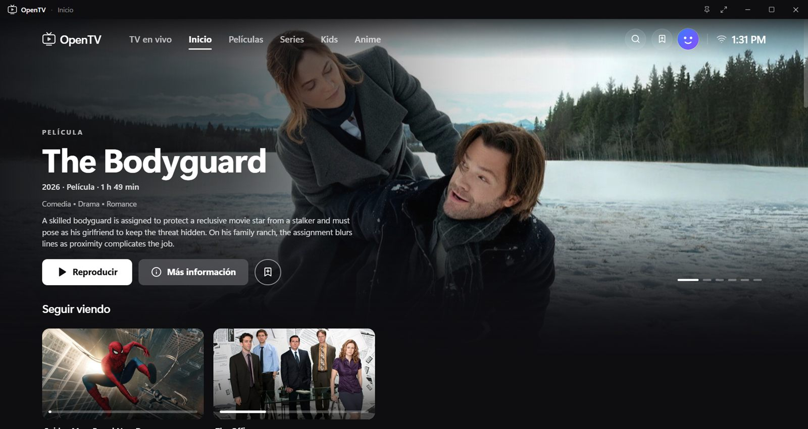
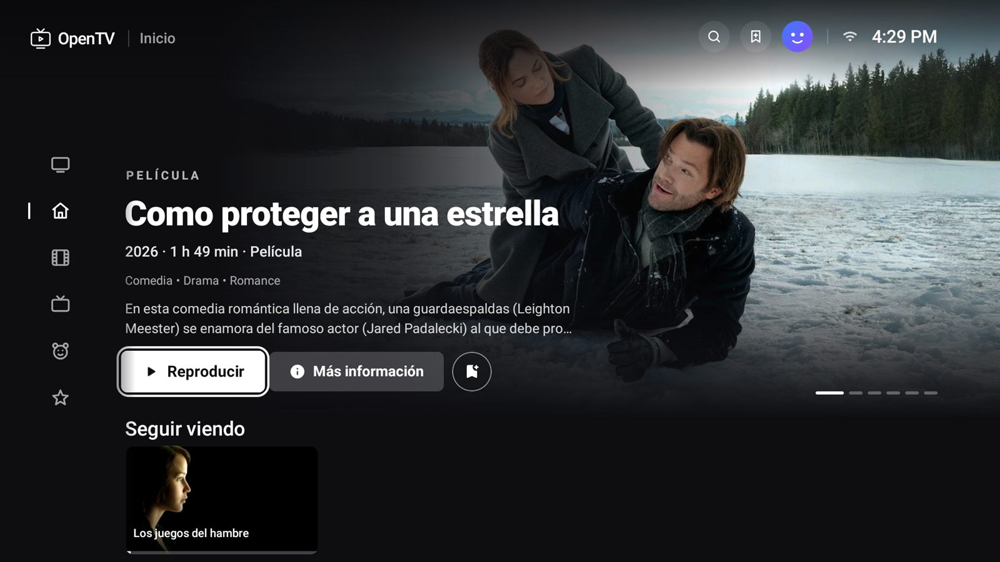
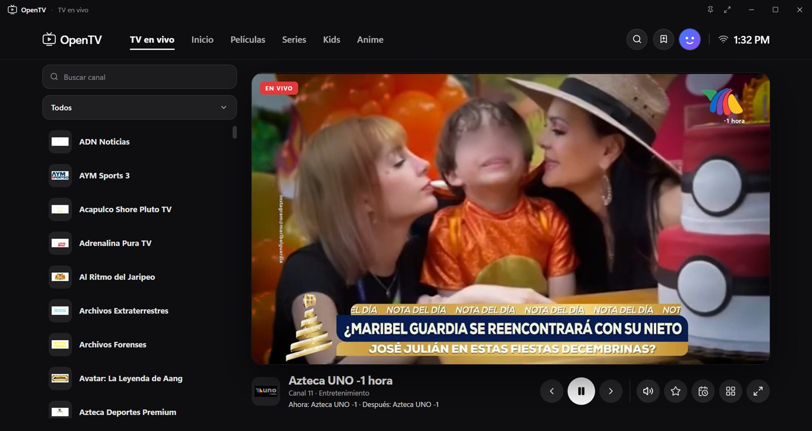
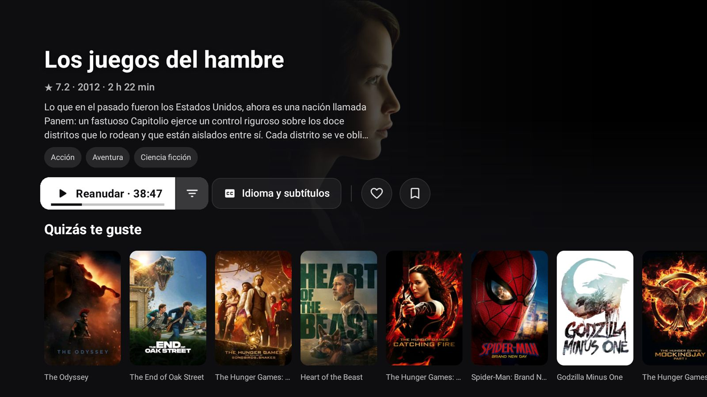

# OpenTV

Reproductor de streaming multiplataforma **sin contenido propio**. Las películas, series y anime vienen de **plugins compatibles con Stremio** y de **plugins comunitarios JS** (`kino-plugin.json`) que corren aislados. La TV en vivo viene de **listas M3U** con guía EPG.

> Esta es la **v2** (Tauri + Kotlin nativo + núcleo Rust). La v1 queda en la rama [`legacy`](../../tree/legacy) y en la etiqueta `v1-legacy`.

| PC (Windows) | Android TV / Fire TV |
|---|---|
|  |  |
|  |  |

Más capturas en [`docs/screenshots/v2/`](docs/screenshots/v2/).

## Qué hace

- **Películas, series, anime y Kids** con catálogos de Cinemeta y Anime Kitsu, más los catálogos de tus plugins. Títulos y sinopsis en español (TMDB es-MX, luego es-ES y al final el original).
- **Fuentes de varios orígenes:** torrents (Torrentio y otros compatibles con Stremio) y fuentes directas HLS/MP4 de plugins JS (Pelispedia, Cuevana Pro, FrameXTV +…).
- **Elige sola la mejor fuente para tu equipo.** Primero el idioma (latino, castellano…). Luego la calidad que aguantan tu equipo y tu red: Full HD en una PC capaz con buena red y HD en equipos modestos o en el Fire TV Stick de 1 GB. En TV prefiere las fuentes directas sobre los torrents.
- **Carga dentro del reproductor** con estados claros ("Buscando la mejor fuente…", "Consultando Pelispedia…", "Cargando video…"). Si una fuente falla o su servidor la rechaza (403/429), prueba sola la siguiente, empezando por otro servidor.
- **Reproduce casi cualquier formato:** MP4, MKV, WebM, HLS, DASH, HEVC, 10-bit y audio AC3/E-AC3/DTS. En PC, lo que WebView2 no decodifica se convierte al vuelo con FFmpeg.
- **Subtítulos** de OpenSubtitles v3, incrustados en el archivo o cargados desde un `.srt`/`.vtt`/`.ass` local, con detección de codificación (UTF-8, UTF-16, Windows-1252).
- **TV en vivo** con listas M3U (Pluto TV y otras), guía "Ahora · Después" y programación de 12 h.
- **Perfiles** con avatares, perfil Kids (solo género Family) y bloqueo con PIN parental.
- **Seguir viendo, Mi lista, Favoritos e Historial**, más copia de seguridad local.
- **Interfaz para el control remoto** en Android TV y Fire TV: foco centrado en las filas, regreso al menú activo y letras grandes.

## Arquitectura

| Plataforma | Tecnología | Carpeta |
|---|---|---|
| **Windows PC** | **Tauri v2** + **React 19 + TypeScript + Vite 6 + Tailwind v4 + Zustand**, con `opentv-core` embebido y FFmpeg | `apps/desktop/` |
| **Android, Android TV y Fire TV** | **Kotlin 2.1** + Jetpack Compose / Compose for TV + Media3 ExoPlayer + JNI Rust | `apps/android/` |
| **Núcleo compartido** | **Rust** (`opentv-core`): torrents `librqbit`, proxy HLS/HTTP/2, M3U, EPG, TMDB, NetGuard, descargas, subtítulos y `/img` | `core/` |

```text
OpenTV/
├── core/                 # Núcleo Rust (opentv-core, opentv-android [JNI], opentv-service [pruebas HTTP])
├── apps/
│   ├── desktop/          # PC: frontend/ (React + TS) y src-tauri/ (Tauri v2)
│   └── android/          # Android, Android TV y Fire TV (Kotlin + Compose)
├── scripts/              # Compilación de PC, Android y Rust
├── tests/                # Contrato HTTP del núcleo y E2E de la interfaz de PC
├── docs/                 # Arquitectura y capturas
└── licenses/             # Licencias de terceros
```

Detalles técnicos en [docs/PLATAFORMAS.md](docs/PLATAFORMAS.md). Historial de cambios en [CHANGELOG.md](CHANGELOG.md).

## Desarrollo

Requisitos: Node 20+, Rust estable, WebView2 (Windows) y, para Android, JDK 17, Android SDK/NDK y `cargo-ndk`.

```bash
npm install                 # Dependencias de la raíz (Tauri CLI)
npm run dev                 # PC en desarrollo (Vite HMR + Tauri v2)
npm test                    # Vitest (PC) + cargo test (Rust) + contrato HTTP del núcleo
npm run test:android        # Pruebas JUnit de Kotlin
npm run build:ui            # Verifica TypeScript y compila la interfaz de PC
npm run build:rust:android  # libopentv_service.so (arm64-v8a + armeabi-v7a)
npm run build:pc            # Instalador NSIS → dist/OpenTV-Setup-<ver>.exe
npm run build:android       # APK release (R8) → dist/
```

Para probar la app de TV usa un **emulador de Android TV** (AVD de 1080p con poca RAM, que imita al Fire TV Stick de 1 GB).

### Secretos (nunca se suben)

- `config/tmdb.json`: clave de TMDB. En PC se embebe ofuscada al compilar; en Android va cifrada en `tmdb.bin`.
- `apps/android/keystore.properties` y `*.jks`: firma de Android.
- `apps/android/local.properties`.

## Seguridad

- El núcleo Rust escucha solo en `127.0.0.1` con token por sesión.
- Los plugins JS corren aislados (iframe `sandbox="allow-scripts"` sin `allow-same-origin` en PC, WebView sin red propia en Android). Toda su red pasa por **NetGuard** en Rust, que bloquea direcciones locales y prefiere IPv4 cuando la red no tiene salida IPv6.

## Licencia

Ver [LICENSE](LICENSE) y [licenses/](licenses/).
